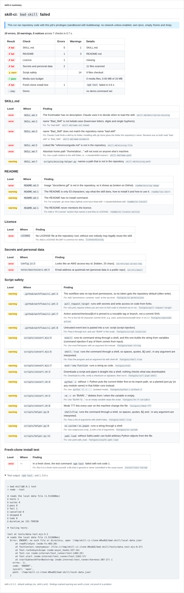

# skill-ci

[](https://github.com/VinVirtual/skill-ci/actions/workflows/test.yml) [](LICENSE)

Check a Claude Code skill repository the way a careful maintainer would before publishing it. One GitHub Action, and the same checks as a local command.



The routine it replaces: open SKILL.md and check the frontmatter, compare the name with the folder, count the description, click every link, look for a licence, grep for keys and email addresses, clone the repo somewhere clean and run the tests, check the media sizes, and read the scripts for `shell=True` and `curl | sh`. skill-ci does all of it on every push and writes the result as a job summary.

It is plain Node.js (20+) and git. No packages to install, no Docker.

## What it checks

| Check | Errors | Warnings |
|---|---|---|
| **SKILL.md** (every one in the repo) | no frontmatter or invalid YAML; `name` missing, not kebab-case, over 64 characters, or not matching the folder (the repository name for a root SKILL.md); `description` missing, over 1024 characters or holding XML tags; empty body; linked file missing; absolute home path | description too short or never says when to use the skill; body over 500 lines; inline-code path under the skill's own folders missing; name with a reserved word |
| **README** | missing; image missing; `git clone ... ~/.claude/skills/<folder>` into a folder not named like the skill | no install command; no licence mention; broken relative link; badge for a workflow that does not exist |
| **LICENSE** | missing or empty | `[year]`-style placeholders; MIT/BSD/ISC without a copyright line; `package.json` names a different licence |
| **Secrets and personal data** | private keys; AWS key ids and secret keys; GitHub, GitLab, Anthropic, OpenAI (new and legacy), OpenRouter, Groq, Slack, Discord, Telegram, Google, Stripe, SendGrid, Twilio, Hugging Face, npm, PyPI and DigitalOcean tokens; Azure storage keys; bearer tokens in `Authorization` headers; npm `_authToken`; JWTs; passwords in URLs; personal email addresses (any script); committed `.env`, `.pem`, `id_rsa`, `.npmrc`, `.pypirc` | hard-coded `password = "..."` or `API_KEY=...`; Stripe test keys; key bodies without a header; home paths that name a user; files that could not be scanned |
| **Script safety** | | `python -c` without `-I`; `shell: true` / `shell=True`; child_process `exec`/`execSync` (stronger when the string is built from variables); `os.system`; `eval` / `new Function`; `curl \| sh`; `rm -rf "$VAR"/`; `chmod 777`; TLS checks off; `yaml.load`. Workflows: actions not pinned by SHA, `pull_request_target`, no `permissions:`, event text pasted into `run:` |
| **Media budget** | a committed media file (images, video, audio, 3D, archives, model weights) over 5 MB; all of them over 15 MB; any other file over 10 MB; the whole repository over 50 MB | |
| **Fresh-clone test** | the repo's tests fail in a clean clone of the last commit | no test command found |
| **Demo** | the configured demo command fails or writes nothing | the outputs were not rewritten |

Every finding carries a rule id (`skill-md/name-mismatch`), a file and line where there is one, and usually a fix. Secret values are never printed: reports give their type and length only.

Script safety findings are warnings on purpose. They are patterns worth a second look, not proof of a hole: `shell: true` with a fixed command is fine. Read the line.

## Install

As a GitHub Action, add [`examples/skill-ci.yml`](examples/skill-ci.yml) to your skill repository as `.github/workflows/skill-ci.yml`. By default it only reads files:

```yaml
on: { push: { branches: [main] }, pull_request: {} }   # pull_request, never pull_request_target
permissions:
  contents: read
# ...
      - uses: actions/checkout@3d3c42e5aac5ba805825da76410c181273ba90b1 # v7.0.1
        with:
          persist-credentials: false
      - uses: VinVirtual/skill-ci@<full commit SHA> # v0.1.0
```

Read [Security](#security) before turning it on for a repository that takes pull requests.

As a local command (and as a skill, so Claude can run it for you):

```bash
git clone https://github.com/VinVirtual/skill-ci ~/.claude/skills/skill-ci
~/.claude/skills/skill-ci/check_env.sh
```

## Quick start

```bash
S=~/.claude/skills/skill-ci
$S/skill-ci check path/to/my-skill --no-run    # read files only: SKILL.md, README, LICENSE, secrets, scripts, media
$S/skill-ci check path/to/my-skill             # also: clone, run the tests, run the demo (runs the repo's code)
$S/skill-ci check . --summary out.md --html out.html --badge badge.json
$S/skill-ci init path/to/my-skill              # write a starter .skill-ci.yml
```

Exit codes: 0 passed, 1 failed, 2 usage or config error. Warnings do not fail the run unless you pass `--fail-on warning`.

## Configuration

Everything is optional. `.skill-ci.yml` at the repository root:

```yaml
name: my-skill                 # expected SKILL.md name (default: repository or folder name)
ignore: [ "tests/fixtures/**" ]  # left out of every check
disable: [ readme/no-install ] # rule ids (or whole checks) to turn off
fail-on: error                 # error | warning | never
checks: { install: true, demo: true }
test:
  install: npm ci              # default: worked out from package.json, requirements*.txt
  command: npm test            # default: package.json "test", else the test step in .github/workflows, pytest, or `make test`
  timeout: 600
demo:
  command: node scripts/demo.mjs --out out
  outputs: [ "out/*.png", "out/*.mp4" ]   # uploaded as a workflow artifact
media: { max-file-mb: 5, max-total-mb: 15, max-other-file-mb: 10, max-repo-mb: 50 }
max-runtime: 1800              # seconds for all repository commands together
sandbox: { mode: auto, network: false }   # bubblewrap: auto | require | off
secrets:
  allowlist: .skill-ci-allow   # one value per line, /regex/ lines, or path:<glob>
  allow-emails: [ "*@my-company.example" ]
footguns:
  ignore: [ "vendor/**", "third_party/**", "dist/**", "**/*.min.js" ]   # the default; a list here replaces it, so repeat these if you still want them
```

Unknown keys are errors with a "did you mean" hint, so a typo never turns a check off quietly. To silence one line, add a comment with `skill-ci: allow` (optionally followed by rule ids) on it.

## Security

skill-ci has two halves, and they carry very different risk.

**The static checks** (SKILL.md, README, licence, secrets, script safety, media) only read files. They are the product, and they are what runs by default. Repository content is treated as hostile here. Output is cleaned of control characters and escape sequences, Markdown outside code spans is escaped, and everything except the annotations is printed inside `::stop-commands::<random>`. Patterns have bounded repetition. Symlinks are not followed. Secret values are never printed, only their type and length. A file that cannot be scanned (unreadable, or over 20 MB) is an error. These measures cover the cases in the test suite; they are not a proof that no input can slip past a pattern.

**The fresh-clone test and the demo run the repository's own code.** That is running someone's code in your job, with your job's privileges. skill-ci cannot make that safe:

- Code running as the job's user can read other processes' environments under `/proc` (including the runner's tokens), the runner's own files, and the checkout's `.git/config`. It can also leave processes behind that outlive the step.
- What skill-ci adds is narrowing, not isolation. Commands get an allow-listed environment and a throwaway HOME. They run in a fresh clone with its remote and reflog removed, and with a time limit. Afterwards their process group, their session, anything carrying a run marker and anything still working inside the clone is killed.
- When bubblewrap (`bwrap`) works on the machine, commands run inside it. The sandbox has its own process, user and network namespaces, so no network (unless `sandbox.network: true`) and no view of other processes. The root is read-only, `/home` and `/tmp` are empty, and only the clone is writable. The summary says "sandboxed with bubblewrap" only when that actually happened. Many runners (containers, Ubuntu 24.04's user-namespace restrictions) cannot run it, and then it is not used. `sandbox.mode: require` refuses to run anything without it.

So running commands is a trust decision you make explicitly:

- `run-commands` is `false` by default, for the action and for the CLI under `--github`. Set it to exactly `"true"`; any other value means false. The summary header then says the run "ran repository code with this job's privileges".
- Turn it on only for your own repository and trusted branches. It never runs for anything but `push` and pull requests from the same repository: not for fork pull requests, `pull_request_target`, `workflow_run`, `issue_comment`, schedules or manual runs. Those events also lock the config (below).
- Put the fresh-clone test in a **separate job** that has `permissions: {}`, `persist-credentials: false` on checkout, no secrets and no steps after skill-ci. A process left behind can then reach nothing worth having. [`examples/skill-ci.yml`](examples/skill-ci.yml) is laid out this way: a static job for every pull request, and a commands job for pushes only.

**Who decides the verdict.** A pull request can edit `.skill-ci.yml`, `.skill-ci-allow` and inline `skill-ci: allow` comments. `lock-config` (on by default for untrusted events; any input value other than exactly `"false"` turns it on) ignores the settings that could hide findings or change limits: `ignore`, `disable`, `fail-on`, `checks`, allowlists, `footguns.ignore`, `media`, `skills`, `name`, `max-runtime` and `sandbox`. A config whose real path is outside the workspace is trusted, so you can check out the base branch's copy elsewhere and pass it as `config`.

## Action inputs and outputs

| Input | Default | |
|---|---|---|
| `path` | `.` | folder of the skill repository |
| `config` | | config file, if not `.skill-ci.yml` |
| `fail-on` | from config | `error`, `warning` or `never` |
| `run-commands` | `false` | exactly `"true"` runs the fresh-clone test and the demo: the repository's code, with this job's privileges. Never for untrusted events |
| `lock-config` | `false` | anything but exactly `"false"` ignores the in-repo settings that could hide findings (always on for untrusted events) |
| `trust-pull-requests` | `false` | exactly `"true"` runs commands and honours overrides for untrusted events too. Dangerous; do not use |
| `badge-file` | | write a [shields.io endpoint](https://shields.io/badges/endpoint-badge) badge JSON here |
| `artifact-name` | `skill-ci-demo` | name of the demo artifact |
| `node-version` | `22` | empty uses the runner's Node |

Outputs: `result` (`pass`, `warn`, `fail`), `errors`, `warnings`, `tests-run`, `badge`. The action writes the job summary, adds file:line annotations to the pull request, uploads the demo files when commands ran (with a pinned `actions/upload-artifact`), and fails the step last, so the artifact is uploaded even when checks fail.

## How it works

1. **File list**: what git would publish (tracked files plus untracked ones that are not ignored). Outside git, a walk that skips `node_modules`, `.venv` and similar.
2. **Static checks** read those files: SKILL.md (with a small built-in YAML reader for frontmatter), README, LICENSE, the secrets scan, the script scan (strings and comments are stripped from JS and Python first, Markdown is scanned only inside code), and the media sizes.
3. **Fresh-clone test** (only when commands are allowed): `git clone` of the last commit into a temp folder named after the repository (remote and reflog removed), then the install and test commands there, inside bubblewrap when it works, with an allow-listed environment and a time limit. The clone is deleted afterwards (`--keep-clone` keeps it).
4. **Demo**: the configured command in the same throwaway clone; the files that match `demo.outputs` are copied to a temp folder for upload.
5. **Report**: console text, Markdown (the job summary), HTML (`--html`), JSON (`--json`) and the badge.

## The example

[`examples/make-example.mjs`](examples/make-example.mjs) runs skill-ci on the two test fixtures and writes [`examples/output/`](examples/output/) and the screenshots in `docs/`:

- `good-skill`: a tidy skill with tests and a demo. Every check passes, the demo writes `out/hello.txt` ([summary](examples/output/good-skill/summary.md), [screenshot](docs/summary-pass.png)).
- `bad-skill`: broken on purpose, with a fake AWS key and a made-up email address planted at run time, and a data file its tests read that was never committed. It fails with 10 errors and 18 warnings; the fresh-clone test fails with `ENOENT: local-data.json` while the same tests pass in the working copy ([summary](examples/output/bad-skill/summary.md), [screenshot](docs/summary.png)).

## Limits

- **Pattern matching, not analysis.** The secrets and script checks match patterns line by line. They miss secrets split across lines or encoded, and they flag test files that hold fake secrets on purpose. Use the allowlist for those.
- **Fake keys that look real are still reported.** Values containing `EXAMPLE`, `dummy` or `placeholder` and stand-in URL passwords (`secret`, `password`) are skipped; anything else is not guessed at.
- The YAML reader covers what frontmatter and the config use (maps, lists, flow collections, quoted, plain and block scalars). Anchors, aliases, tags and multiple documents are refused with a clear error rather than guessed.
- The fresh-clone test runs the repository's own code (see [Security](#security)). Only run it on code you trust. Inside bubblewrap there is no network unless `sandbox.network: true`, so installs that download packages fail without it.
- Media budget counts committed files only; Git LFS pointers count as their small pointer size.
- Tested on Linux (Node 22 and 24). It needs `bash` and `git`; macOS should work, Windows has not been tested.

## Development

```bash
./skill-ci test      # 168 tests with node --test: the YAML reader, config validation, globs, every check on
                     # strings and on throwaway git repos built from the fixtures, fresh clones, the demo,
                     # Markdown/HTML/annotation/badge output, the command line end to end, and security
                     # regressions (event trust, fail-closed inputs, environment allow-list, bubblewrap when
                     # usable, leftover-process sweep, symlinks, injection into workflow commands and the
                     # summary, pattern timing on hostile input, locked config, redaction)
```

The workflow in [`.github/workflows/test.yml`](.github/workflows/test.yml) runs the tests, then runs the action itself on both fixtures (the good one must pass and upload its demo, the bad one must fail with at least 5 errors) and on this repository. Fake secrets in the tests are assembled at run time, so none is committed.

## License

MIT, see [`LICENSE`](LICENSE).
